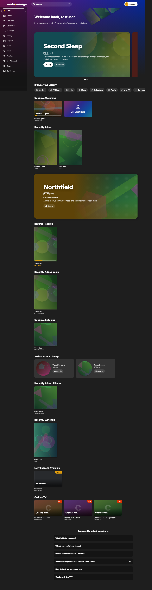

# Screenshot Update Procedures

This file documents how to regenerate the documentation screenshots.

## Web app (canonical flow)

```bash
./lifecycle/capture-web-screenshots.sh
```

That wrapper runs `web-app/tests/ci-run.sh docs`, which starts the dev
server and drives Playwright through `web-app/tests/visual/docs.spec.ts`
(via `tests/visual/docs.mjs`). PNGs are written into
`docs/images/screenshots/`, overwriting whatever was there. It needs
nothing but the web-app dependencies (`npm ci` under `web-app/`): no
server, no accounts, no secrets.

### Why the pictures come from the mocked app

The pages are rendered against the same request mocks the Playwright
suites use, with two substitutions so the result can be published:

- **Artwork.** Every poster, backdrop, cover, and headshot is generated
  abstract artwork (`tests/helpers/image-stub.ts`, `artFor`): a
  gradient, a few translucent shapes, and a grain, all derived from the
  image URL, so the same title always draws the same picture. Nothing in
  it is a real poster. TMDB images are licensed for display inside the
  app, not for redistribution, and the film artwork itself belongs to
  the studios.
- **Names.** The fixtures name real films, shows, albums, books, and
  people so the suites read naturally. For screenshots those are swapped
  for invented names at the mock boundary
  (`tests/helpers/fictional-names.ts`, enabled by `MM_FICTIONAL_NAMES=1`,
  which only `docs.mjs` sets). When a fixture gains a real-world name,
  add a row to that table.

The viewport is 1280 × 800 in the Marquee theme. Pages whose content
runs below the fold (home, the title pages, the wish list, settings,
purchase wishes) are captured full page.

### Manifest

Routes are relative to the SPA mount (`/app/`). "Mock" is the
`mockBackend` option set; `viewer` and `admin` are the two feature-flag
fixtures, both with the populated home feed.

| File | Route | Mock | Notes |
|------|-------|------|-------|
| `login.png` | `/login` | none | Empty sign-in form |
| `setup-wizard.png` | `/setup` | none, `discover: setup-required` | First-run form |
| `home.png` | `/` | viewer | Full page: welcome, heroes, chips, rows, FAQ |
| `home-top.png` | `/` | viewer | Above the fold, for the README |
| `home-empty.png` | `/` | viewer, `homeFeed: empty` | New-account home |
| `catalog.png` | `/content/movies` | viewer | Movies grid with filter pills |
| `catalog-tv.png` | `/content/tv` | viewer | TV grid |
| `search.png` | `/search?q=harbor` | viewer | Mixed-type results |
| `title-detail-movie.png` | `/title/100` | viewer | Full page, through Similar Titles |
| `title-detail-tv.png` | `/title/200` | viewer | Full page, seasons and episodes |
| `player.png` | `/play/42` | viewer + player stubs | Synthetic 20 s clip (`tests/fixtures/player`); mouse moved so the controls show |
| `wishlist.png` | `/wishlist` | viewer | Full page: media, transcode, and book wishes |
| `profile.png` | `/profile` | viewer | Account, quality filter, passkeys, sessions |
| `settings.png` | `/admin/settings` | admin | Full page |
| `users.png` | `/admin/users` | admin | User table |
| `transcode-status.png` | `/admin/transcodes/status` | admin | Progress and recent activity |
| `purchase-wishes.png` | `/admin/purchase-wishes` | admin | Full page, aggregate wishes |

To add a page, add a row to `SHOTS` in `tests/visual/docs.spec.ts` with
the route, a selector that proves the page rendered, and the mock
options; reference the file from the guide that needs it.

## Embedding screenshots in markdown

Use the link-wrapped image pattern so docs render a thumbnail and the
user can click to open the full-resolution PNG in a new tab:

```markdown
<a href="images/screenshots/home.png" target="_blank">
  
</a>
```

GitHub honors the `width` attribute, so the same PNG serves as both
the inline thumbnail and the full-res target &mdash; no separate
thumb file needed. Use `width="640"`; the full-page captures render
fine at that width even though their intrinsic height is much taller.

## iOS App Store screenshots (separate flow)

> These shots are taken from the real app in screenshot mode, which
> replaces every title, person and image with invented ones (below), so
> they are safe to publish and are committed under
> `docs/images/screenshots/ios/`.

App Store Connect takes 1 to 10 screenshots per device size, PNG or
JPEG with no transparency, at sizes it lists per device class
([screenshot specifications](https://developer.apple.com/help/app-store-connect/reference/screenshot-specifications),
read 2026-11-13). The capture uses the newest simulator in each class:

| Device | Size | App Store Connect class |
|--------|------|-------------------------|
| iPhone 18 Pro Max | 1320x2868 | iPhone with Dynamic Island, large display |
| iPhone 18 Pro | 1206x2622 | iPhone with Dynamic Island, medium display |
| iPad Pro 13-inch (M5) | 2064x2752 | iPad 13" display (required when the app runs on iPad) |
| iPhone Duo, outer display | 1398x2034 | iPhone Duo |

The iPhone Duo's inner display (2007x2853) is not captured yet; see
"iPhone Duo" below.

Smaller and older classes are scaled from these by App Store Connect.
Duo screenshots become required in April 2027 for apps built with the
iOS 27.1 SDK or later. None of these sizes has yet been through a real
submission: the app has only been on TestFlight.

**Driver:** `lifecycle/capture-ios-screenshots.sh [prelogin|viewer|all]`.
It takes the server address and accounts from the environment, from
`secrets/ios-screenshots.agent_visible_env`, or from the demo server's
`app_store_demo_setup/secrets/.env` (first match wins; the script's
header has the details). For each device and phase it:

1. Builds the XCUITest target once.
2. Creates a fresh disposable simulator with a `MM-Snap-*` prefix, on
   the newest runtime that supports the device (the Duo has a runtime
   of its own). It never reuses an existing simulator, which may be
   signed in to a real server.
3. Runs one test from `MediaManagerUITests/SnapshotTests`, with the
   credentials propagated through `TEST_RUNNER_MM_SNAPSHOT_*` env vars
   to the test runner, then through `app.launchEnvironment` to the app.
4. Extracts the captured `XCTAttachment` PNGs from the `.xcresult`
   bundle via `xcrun xcresulttool export attachments`.
5. Tears down the simulator on success; leaves it (and prints its
   UDID) on failure for forensics.

`MM_SNAPSHOT_DEVICES`, a space-separated list of simulator names,
limits a run to some devices.

**Two phases, two accounts.** A server shows its terms screen only
until an account agrees to them.

- `prelogin` (`testPreLoginShots`) captures the app's policy screen,
  server setup, the login form and the server's terms screen, and
  stops there without agreeing. Give it an account that is never used
  for anything else (`MM_SNAPSHOT_USERNAME`): it then shows the terms
  screen on every device, every time.
- `viewer` (`testViewerShots`) signs in, agrees to the terms if it
  must, and captures the signed-in screens. Give it an account with
  some history (`MM_SNAPSHOT_VIEWER_USERNAME`): films in progress, a
  book started, a playlist, a few wishes, so Home has rows to show.

**iPhone Duo.** The outer display is captured like any other device.
The inner display is not: its entry in the script's device list is
commented out, and
[issue #30](https://github.com/jeffbstewart/MediaManager/issues/30)
records what was tried. In short, the simulator can only be unfolded
by hand, with the fold control in the Device Hub window, and once it
is unfolded the UI test still photographs the outer display. The
simulator's own `simctl io screenshot --display=N` does capture the
inner display, so the likely fix is to take the pictures from the
script, cued by the test.

**Screenshot mode:** published screenshots must not name real films,
shows, books or albums, show their artwork, or show the server's
address. The `-MMSnapshotMode` launch arg turns on screenshot mode
(`ScreenshotMode` in `ios/MediaManagerCore`), which does three things:

- **Names.** Every title, episode, album, track, person, character,
  synopsis and biography is replaced with an invented one, as is the
  signed-in user's display name. A name is chosen by hashing the real
  one (`Fiction`), so the same title reads the same on every screen and
  a library of any size is covered. The vocabulary is the one behind
  the web screenshots' `fictional-names.ts`. Tags, genres and playlist
  names are the user's own words and are left alone.
- **Artwork.** Every image the app loads is replaced with generated
  abstract artwork (`GeneratedArt`, a Swift port of `artFor` in
  `web-app/tests/helpers/image-stub.ts`). Nothing real is fetched or
  cached while the mode is on.
- **Address.** `ServerSetupView` skips SSDP discovery (no "Server
  found" banner) and `LoginView` suppresses the `serverURL.host()`
  text. The `server-setup` shot is captured before any URL is typed.

Because the substitution happens in the app, the capture can run
against any server, including one with a real library. The mode is for
screenshots only: text sent back to the server is not translated, and
video frames, book pages and the Downloads list are not covered.

It can also be switched on a device: four taps on the **Build** row of
the About screen, then restart the app. The same gesture turns it off.

**Output.** The raw PNG captures go to
`ios/MediaManager/fastlane/screenshots/en-US/<simulator>/`, which is
gitignored. Each is also saved to `docs/images/screenshots/ios/` as
`<device>_<screen>.jpg` (JPEG, quality 90), and those are committed.
The JPEGs are the ones to upload, so the store listing matches the
record; they are about a fifth the size of the PNGs, which matters
because git keeps every past capture.

- `app-store/` is the set to upload, for each device in this order:

  | Order | Screen | Shows |
  |-------|--------|-------|
  | 1 | `home` | Home: greeting, featured title, Continue Watching |
  | 2 | `movies` | Movies grid |
  | 3 | `tv-show` | The first show in the TV grid |
  | 4 | `books` | Books, by author |
  | 5 | `music` | Music: playlists and recent albums |
  | 6 | `wish-list` | Wish List |
  | 7 | `server-setup` | The app's first-run screen for entering a server address |

- `reference/` is kept for the record and not uploaded: `app-policy`,
  `login` (the empty form) and `server-terms`. Screenshots of sign-in
  and legal screens do not show the app in use, which App Review
  guideline 2.3.3 asks for.

Look through every image before uploading. Screenshot mode covers the
names and artwork the app is known to show; a new screen or field can
add one it does not.

**Prereqs:** a reachable server and two viewer accounts on it (above).
Either copy `secrets/example.ios-screenshots.env` to
`secrets/ios-screenshots.agent_visible_env` and fill it in, or, for the
demo server, populate `app_store_demo_setup/secrets/.env` (see
`example.env`) and make sure its `viewer` account exists. No account
name appears in a screenshot. Do not use an admin account. The
`reviewer-*` accounts are reserved for Apple App Review and must never
be used by this pipeline.

## Roku screenshots (separate flow)

Roku screenshots use an HDMI capture card + OBS Virtual Camera +
FFmpeg, not Playwright.

**Setup:**

1. Connect HDMI capture card to the Roku.
2. Open OBS, add the capture card as a Video Capture source.
3. Start Virtual Camera in OBS (Output Type: Program).
4. Use `./lifecycle/roku-screenshot.sh <path>` to capture frames.

**Reproducing:** Deploy the dev channel to the Roku first
(`./lifecycle/roku-deploy-dev.sh`). The channel must have data to show
&mdash; the server should be running with enriched titles and
playable transcodes.

| File | Roku Screen | Notes |
|------|-------------|-------|
| `roku-home.png` | Roku Home | Navigate to the Roku home screen. Select the "Media Manager (dev)" channel tile so it has the white selection outline. The channel name and item count appear above the tile row. Shows the real artwork of whatever is in the library; a mocked equivalent does not exist for Roku. |

## Referenced In

- `README.md` &mdash; home-top
- `docs/USER_GUIDE.md` &mdash; home, home-empty, catalog, catalog-tv, search, title-detail-movie, title-detail-tv, player, wishlist, profile
- `docs/ADMIN_GUIDE.md` &mdash; settings, transcode-status, users, purchase-wishes
- `docs/ROKU_GUIDE.md` &mdash; roku-home

## Notes

- All screenshots saved as PNG.
- `data/screenshots/` is for throwaway/debug screenshots (gitignored).
- `docs/images/screenshots/` is for committed doc screenshots.
- Roku screenshots are captured via `lifecycle/roku-screenshot.sh`
  (FFmpeg pulling from OBS Virtual Camera).
